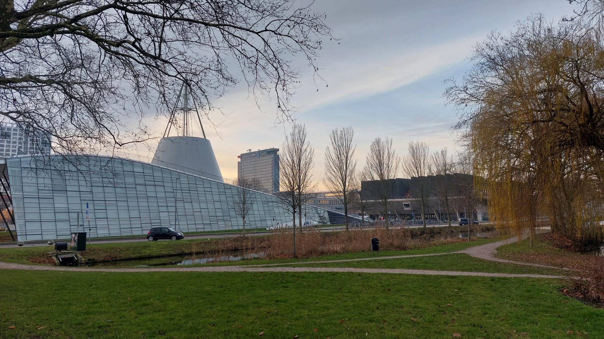

+++ { "kind": "split-image" }

## 2D Materialen

De module is gerealiseerd door
*Sjors van der Schot*

Onder begeleiding van:
- *Rutger Ockhorst*
- *Prof.dr. S.C. Conesa Boj*

+++

Deze module is ontwikkeld als onderdeel van het vak SL4400 Bètatechnische Onderwijsinnovatie
Ten behoeve van de master Science Education and Communication aan de TU Delft
